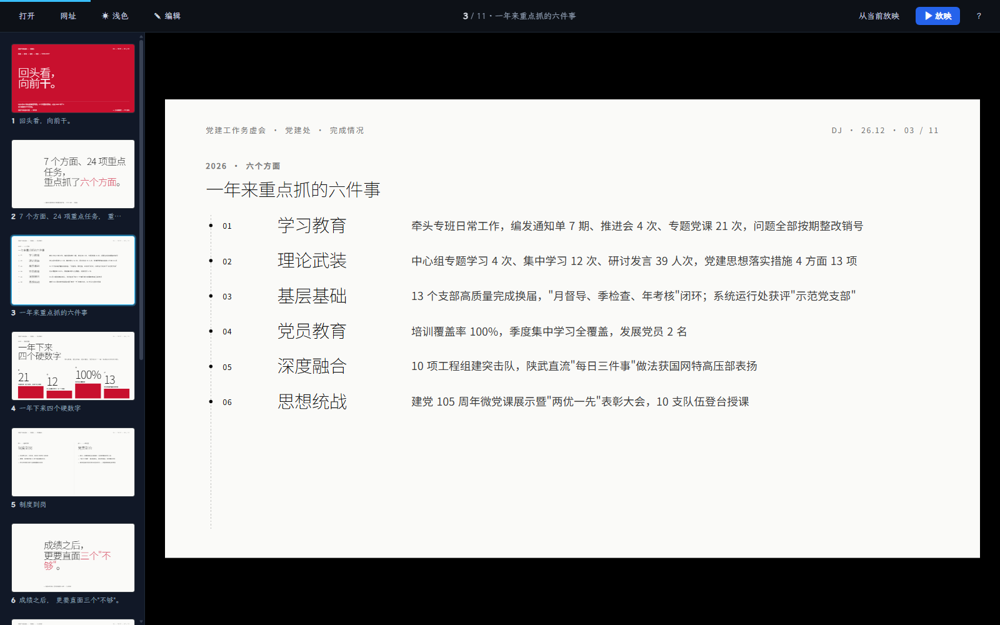
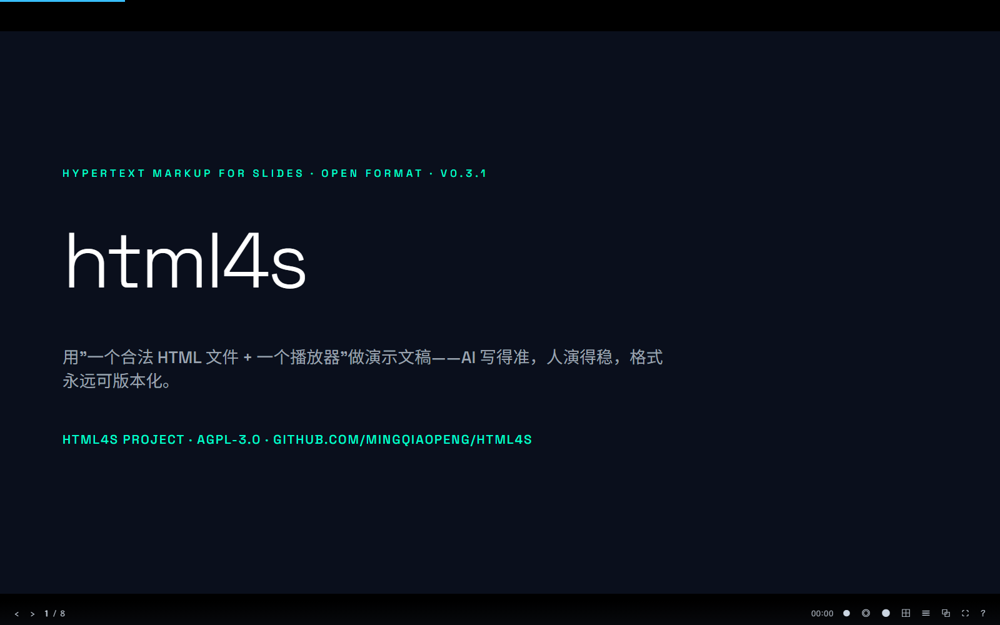
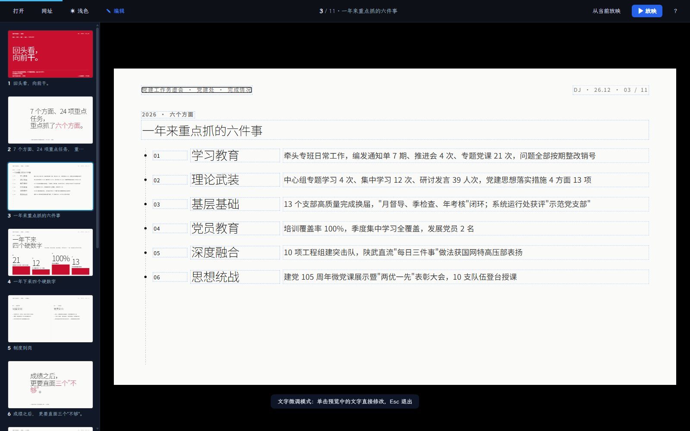
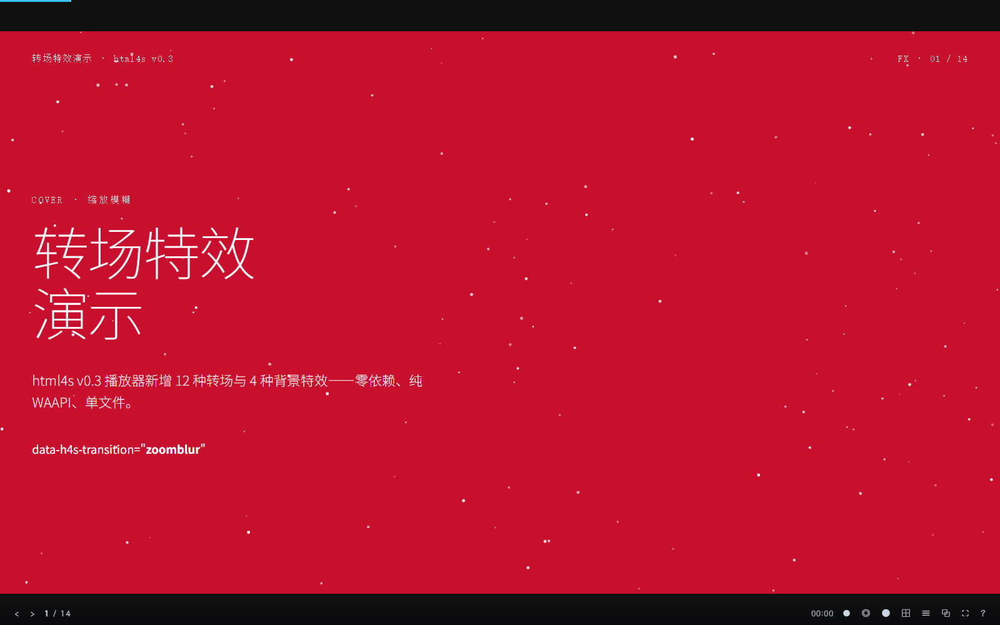

# html4s

**HyperText Markup Language For Slides** — 用"一个合法 HTML 文件 + 一个播放器"做演示文稿。

> AI 写得准，人演得稳，格式永远可版本化。

[]() []() []()

设计规范与路线图见 [ARCHITECTURE.md](ARCHITECTURE.md)（格式规范正式文本见 [docs/SPEC.md](docs/SPEC.md)）· 许可归属见 [docs/NOTICE.md](docs/NOTICE.md)

> 🌐 **在线演示与默认参考：<https://mingqiaopeng.github.io/html4s/>** —— 主题库画廊（6 主题 · 8 个在线播放 deck）+ 键位速查 + 文档导航，浏览器直接打开；桌面客户端内按 **Ctrl+D** 或右键标题栏 →"在线演示站…"同样直达。

---

## 为什么做这个：AI 生成演示文稿的三重困境

用 AI 做 PPT 已经是刚需，但三条路都走不通：

**1. pptx 路线——AI 是"摸黑"生成的。**
pptx 是 zip 包着 XML，AI 必须借助 python-pptx 之类的脚本逐个操作对象，看不到自己排出来的版面。autofit 行为是黑盒，字体缩放不可预测，生成的版式经常崩坏；二进制进版本库，diff 无从读起。

**2. HTML 演示路线（reveal.js / Slidev 等）——生成容易，"演"不起来。**
HTML 是 AI 能直接写的，但写完的页面只是一个网页：没有 PowerPoint 式的浏览界面、没有缩略图侧栏、演讲者视图依赖额外配置、排练计时/kiosk/文件写回一概没有。现场演示要靠浏览器裸奔。

**3. 分发困境。**
reveal.js 需要整个框架目录或 CDN；Slidev 需要 Node 工程 + Playwright 导出；pptx 单文件但二进制。想给同事发一个"双击就能放"的东西，三条路都别扭。

**html4s 的答案**：把"播放器"做成独立软件，把"文稿"做成一个纯文本 HTML 文件。AI 直接写 HTML（排版确定性、git 可版本化），播放器负责一切演播能力（双击即演、零依赖、离线可用）。

---

## 与竞品的对比

| 维度 | PowerPoint (pptx) | reveal.js | Slidev | **html4s** |
|---|---|---|---|---|
| AI 直接生成 | ⚠️ 脚本摸黑（XML） | ✅ 写 HTML，但需框架目录 | ✅ 写 Markdown，需 Vue 工程 | ✅ **写 HTML，零依赖单文件** |
| 演播体验（缩略图/演讲者/计时） | ✅ 原生 | ⚠️ 插件配置 | ✅ 较全 | ✅ **原生全功能 + 双屏副屏** |
| 排版确定性 | ❌ autofit 黑盒 | ⚠️ 滚动风险 | ⚠️ 布局可能溢出 | ✅ **固定舞台 1920×1080 等比缩放** |
| 字体离线内嵌 | ⚠️ 手动嵌入 | ❌ 需自配 | ⚠️ 需配置 | ✅ **构建期子集内嵌（1116KB→34KB）** |
| 版本控制友好 | ❌ 二进制 | ✅ | ✅✅ Markdown | ✅ **纯文本，逐行可 diff** |
| 分发形态 | ✅ 单文件（zip 容器） | ❌ 框架目录/CDN | ❌ 需构建导出 | ✅ **单文件双击即演** |
| 非开发者使用门槛 | 低 | 中 | 高（Node 工程） | **低（安装后双击）** |
| AI 质量闭环（lint/截图/自审） | ❌ | ❌ | ⚠️ 部分 | ✅ **lint 7 类检查 + 逐页截图 + 构建指纹** |

一句话：**pptx 演得动但 AI 写不好；reveal/Slidev 写得好但分发与演播沉重；html4s 把"AI 写"和"人演"放在两个都做到位的层上。**

---

## 主要优点

### 📦 一个文件，双击即演
`.html4s` 是一个合法的 HTML 文件——播放器运行时、图标库、字体子集**全部内嵌**，拷到 U 盘、发邮件、传网盘，演示机上零依赖、离线可用。

### 🎬 播放器专职演播
PowerPoint 式浏览界面（缩略图侧栏 + 页码指示器）、**20 种转场**（含 PowerPoint 幕布/百叶窗/棋盘/像素溶解等 4 种遮罩式）、背景特效层（星空/雪花/尘埃）与页面礼花、演讲者双窗口（副屏自动放置）、同屏抽屉（备注字号可调 + 下一页预览 + 计时）、排练计时写回 `.timings.json`、kiosk 循环放映、深链直达任意页/碎片。

### 🤖 为 AI 创作而生的工具链闭环
```
AI 按 skill 写 deck → h4s-lint（7 类检查 + HTML 分页报告）→ h4s-shot（逐页截图自审）
→ 修复回环 → h4s-build（字体子集化 + 单文件交付）→ 双击验收
```
MCP server 把 lint/shot/outline/build/pdf/slides 增量编辑与 **h4s_review（一键结构化验收结论）** 暴露给 AI Agent，打开项目即自动连接。

### 🇨🇳 中文演示优先
- **中文可读性适配层**：正文 26px 下限（西文模板常见的 16px 正文投影到会议室后排不可读）
- **字体子集内嵌**：中文 deck 从"字体 1116KB 太大"到"子集 34KB"
- **党政/政务风格**：内置品牌色生成（`gz-theme`）与红色主题示例 deck

### ✏️ 演讲前文字微调
浏览模式点 **✎ 编辑**，预览中直接改字——自动同步回文件（壳版写回源文件）、自动检测字体子集缺字并预警、壳内一键写回源文件并提示重建。

### 🖥️ 双宿主
同一份文件：**壳版**（Windows，WebView2 内核）全功能演播；**浏览器版**拖进 Edge/Chrome 也能播（自动降级），发给别人预演零门槛。

---

## 不适用的场景（诚实说明）

- **需要 Office 协作流程的团队**——批注、审阅、修订追踪请继续用 PowerPoint
- **复杂定制动画**——有逐元素碎片与转场，但不是 PPT 那种可视化动画编辑器
- **数据联动/实时图表**——图表请预先生成或用截图
- **想在 PowerPoint 里继续编辑**——html4s 是"终点格式"，不是 pptx 的替代输入
- **低端设备 + 重特效**——WebGL 背景与粒子层在集成显卡上可能掉帧（可关闭 fx）
- **跨平台桌面壳**——目前 Windows（macOS 计划走 Tauri/WKWebView）

---

## 界面预览

**PowerPoint 式浏览界面**（缩略图侧栏 + 页码指示器 + 舞台预览 + 深色主题）：



**全屏放映**（固定舞台等比缩放，党建红主题示例）：



**文字微调模式**（预览中直接改字，蓝框聚焦、黄框缺字预警）：



**背景特效**（星空层 + 转场，零依赖 canvas）：



---

## 使用说明

### 安装（Windows 10/11）

1. 下载 [release/html4s-0.6.0-setup.exe](release/html4s-0.5.0-setup.exe) 运行（用户级安装，无需管理员）
   - 自动注册 `.html4s` 双击关联 + 桌面/开始菜单快捷方式
2. 或用免安装版 [html4s-0.5.0.zip](release/html4s-0.6.0.zip)，运行 `Html4sPlayer/Html4sPlayer.exe`

需要 WebView2 运行时（Windows 10/11 系统自带）。

### 示例 deck

**项目介绍 deck**（本 README 的演示版，frontend-slides-html4s 技能生成）：[examples/html4s-intro-fs.html4s](examples/html4s-intro-fs.html4s) —— 8 页含竞品对比表、主要优点、不适用场景与背景特效演示。双击或拖入播放器即可放映。

### 播放

| 操作 | 按键 |
|---|---|
| 打开文件 / 网址 | Ctrl+O / Ctrl+L |
| 最近打开 / 设置 / 关于 | Ctrl+R / Ctrl+, / 右键标题栏 |
| 从头 / 从当前页放映 | F5 / Shift+F5 |
| 翻页 / 碎片 | → ↓ 空格 / ← ↑ |
| 总览网格 / 黑屏 / 白屏 / 激光笔 | G / B / W / L |
| 演讲者抽屉（同屏练习） | S |
| 排练计时（写回 .timings.json） | R 开始 / R 结束 |
| 连接翻页笔（WebHID，实验性） | J（多数翻页笔是键盘设备，直接可用） |
| 文字微调模式 | ✎ 编辑按钮 |
| kiosk 循环放映（隐藏 UI） | `--kiosk` 启动参数（解锁：Ctrl+Alt+Q） |

### 创作（AI Agent 工作流）

三个创作技能（[skills/](skills/)）内含视觉体系、锁定版式与质量清单。**第 0 步读 [docs/DECK-DESIGN.md](docs/DECK-DESIGN.md)**（AI 先读的决策指南：场景 → 主题 8 选 1 → 叙事骨架 → 版式分配 → 特效强度）：

```bash
# 1. AI 按 skill 写 deck（HTML 源文件）
# 2. 校验 → 逐页截图自审 → 构建单文件
node tools/h4s-lint.mjs  my-deck.html            # 溢出/字号/对比度/tofu 检查（--html 出分页报告）
node tools/h4s-shot.mjs  my-deck.html            # 逐页 PNG 视觉自审
node tools/h4s-build.mjs my-deck.html --subset   # 字体子集内嵌 → my-deck.html4s
# 3. 双击 my-deck.html4s 验收
```

### 📊 声明式图表（0.4.0 新增）

```html
<h4s-chart type="bar">
[{"label":"营收","value":4200},{"label":"利润","value":3100}]
</h4s-chart>
```

元素内写 JSON 数据 → 零依赖 SVG 渲染，颜色随主题换肤，放映时数据生长动画。AI 写数据不写图——lint 可校验数据合法性。支持 bar / hbar / line / pie / donut 五种类型。

### 🧩 版式模板库与脚手架（0.4.0 新增）

20 种典型页面版式（封面/目录/章节页/大字观点/对比图/流程图/时间线/数据看板/引用/图文/清单/收束等）——每个版式一个可复制片段，全部走 CSS 变量与 8 主题正交组合。**一条命令生成 starter deck**：

```bash
node tools/gen-deck.mjs --theme partyred --title "季度经营汇报" --outline outline.md
```

决策依据见 [docs/DECK-DESIGN.md](docs/DECK-DESIGN.md)（AI 先读：场景 → 主题 → 骨架 → 版式 → 特效）。

增量编辑、字体与迁移：

```bash
node tools/h4s-slides.mjs insert my-deck.html --after 3 --file new-page.html   # 插页 + 自动重编页码
node tools/h4s-slides.mjs sync   my-deck.html --build                          # 页码重编 + 重建产物
node tools/h4s-fonts.mjs scan --need "方正小标宋"                               # 扫描系统字体给内嵌推荐
node tools/import-reveal.mjs reveal-deck.html                                  # reveal.js → html4s 源
node tools/import-pptx.mjs  deck.pptx                                          # pptx → html4s 源（文本/图片/备注）
```

构建加 `--share` 同时产出浏览器直开的 `.share.html`（无壳机器直接拖进浏览器即可播放）。一键发布管线：

```bash
node tools/release.mjs        # 全 deck 重建（playerVersion 指纹）→ lint 门禁 → 回归 → staging → ISCC → zip → 静默自检
```

MCP 接入见 [docs/MCP-SETUP.md](docs/MCP-SETUP.md)，壳/Web 能力差异见 [docs/CAPABILITIES.md](docs/CAPABILITIES.md)。

---

## 目录结构

```
player/    播放器运行时（h4s.player.js ~100KB 零依赖单文件）
shell/     Windows 桌面壳（.NET 10 + WebView2）
tools/     工具链（lint/shot/pdf/build/slides/fonts/cdp/mcp/release/导入器）
skills/    三个创作技能（guizang / frontend-slides / huashu）
examples/  示例 deck（项目介绍 intro-fs / 一致性基准 conformance / 转场特效 fx-showcase / 党建示例等）
docs/      架构 / 格式规范 SPEC / 发布说明 / 能力矩阵 / 许可 / MCP 注册
```

## 许可

- **本项目**：AGPL-3.0
- **视觉体系**：guizang-ppt-skill 与 huashu-design 派生（[AGPL-3.0](https://github.com/op7418/guizang-ppt-skill)）、frontend-slides（MIT），归属见 [docs/NOTICE.md](docs/NOTICE.md)
